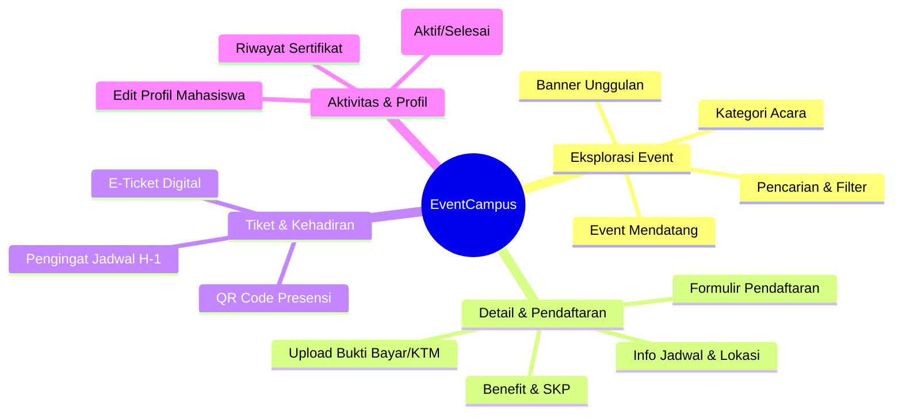
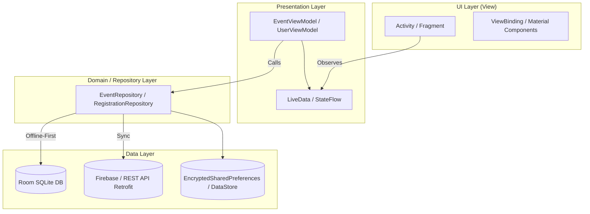
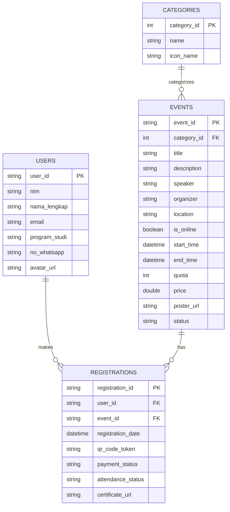

# EventCampus: Aplikasi Informasi & Pendaftaran Kegiatan Kampus Berbasis Android
*Dokumen Perancangan Sistem, Desain UI/UX, dan Arsitektur Aplikasi*

---

## 1. Pendahuluan & Latar Belakang

### 1.1 Latar Belakang
Di lingkungan perguruan tinggi, informasi kegiatan mahasiswa (seminar, workshop, webinar, kompetisi, rekrutmen panitia, hingga kegiatan UKM/BEM) sering kali tersebar di berbagai kanal yang tidak terpusat (Instagram, grup WhatsApp, poster fisik di mading). Hal ini menimbulkan kendala:
- Mahasiswa sering melewatkan informasi penting atau terlambat mendaftar.
- Panitia penyelenggara kesulitan mendata peserta, memvalidasi bukti pendaftaran, dan membagikan sertifikat.
- Rekam jejak keikutsertaan kegiatan mahasiswa (poin SKP/keaktifan) sulit dikelola secara terpusat.

**EventCampus** hadir sebagai solusi aplikasi mobile Android terpadu yang memudahkan mahasiswa menemukan informasi kegiatan kampus terkini dan mendaftar secara praktis melalui smartphone.

---

## 2. Analisis Kebutuhan Sistem & Pengguna

### 2.1 Aktor / Persona Pengguna
1. **Mahasiswa (Peserta)**:
   - Menelusuri kegiatan berdasarkan kategori, tanggal, atau penyelenggara.
   - Mendaftar kegiatan (gratis maupun berbayar).
   - Menerima e-ticket / QR Code untuk presensi saat acara.
   - Mengunduh e-sertifikat kegiatan yang telah diikuti.
2. **Panitia / Ormawa (Penyelenggara)**:
   - Mengunggah info kegiatan baru (banner, deskripsi, kuota, jadwal).
   - Memvalidasi data pendaftar dan bukti pembayaran (jika ada).
   - Melakukan scan QR Code peserta saat kegiatan berlangsung (presensi kehadiran).
3. **Administrator Kampus**:
   - Memverifikasi legalitas kegiatan yang diajukan oleh panitia/ormawa.
   - Memantau statistik keaktifan kegiatan di kampus.

---

## 3. Fitur Utama Aplikasi

### Rincian Fitur:
1. **Onboarding & Autentikasi**:
   - Registrasi & Login (NIM, Nama, Email Kampus, Password).
2. **Dashboard / Beranda**:
   - Header personalisasi: *"Halo, [Nama Mahasiswa]"*.
   - Search bar real-time & chip filter kategori (Seminar, Workshop, Lomba, Kepanitiaan, Seni & Olahraga).
   - Carousel banner event unggulan/terhangat.
   - Card daftar event horizontal & vertikal dengan indikator kuota dan status (Gratis/HTM).
3. **Halaman Detail Event**:
   - Poster/banner resolusi tinggi.
   - Badge kategori & status kegiatan.
   - Informasi terstruktur: Tanggal & Waktu, Tempat (Offline/Online via Zoom), Penyelenggara, Kuota tersisa.
   - Tab Deskripsi, Pembicara, dan Benefit (E-Sertifikat, Poin SKP, Snack, Relasi).
   - Bottom Action Bar: Tombol *"Daftar Sekarang"* dengan status kuota real-time.
4. **Formulir Pendaftaran**:
   - Data diri otomatis terisi dari profil akun (NIM, Nama, Prodi, No. WhatsApp).
   - Input khusus (misal: alasan mengikuti, link berkas pendukung).
   - Upload struk pembayaran jika event berbayar.
5. **Menu "Tiket Saya" (My Events)**:
   - Tab *Mendatang* (Upcoming) dan *Riwayat* (Past Events).
   - Halaman detail tiket dilengkapi QR Code unik untuk validasi kehadiran di meja registrasi.
6. **Profil & Riwayat**:
   - Data pribadi dan statistik keikutsertaan event.
   - Galeri e-sertifikat yang bisa diunduh langsung.

---

## 4. Arsitektur Teknis Aplikasi

Aplikasi dibangun menggunakan prinsip **MVVM (Model-View-ViewModel)** dengan **Clean Architecture pattern** pada Android:

### Stack Teknologi yang Direkomendasikan:
- **Bahasa**: Kotlin (Modern Android Development).
- **UI Framework**: XML Layouts dengan **Material Design 3 (M3)** + ViewBinding.
- **Navigasi**: Android Navigation Component / BottomNavigationView.
- **Database Lokal**: Android Room Database (SQLite ORM) untuk caching offline.
- **Backend / Realtime Sync**: Firebase (Firestore, Auth, Storage) atau RESTful API (PHP Laravel / Node.js Express via Retrofit).
- **Asinkron**: Kotlin Coroutines & Flow.
- **Image Loader**: Glide atau Coil.
- **Barcode / QR Code**: ZXing Android Embedded untuk scan & generate QR Code tiket.

---

## 5. Perancangan Basis Data (Database Schema)

---

## 6. Desain Visual & Identitas Brand (Design System)

### 6.1 Palet Warna Modern (Material 3)
| Peran Warna | Hex Code | Deskripsi & Penggunaan |
|---|---|---|
| **Primary (Utama)** | `#0D47A1` | Biru Navy Kampus: Memberikan kesan akademis, profesional, dan tepercaya. |
| **Primary Container** | `#E3F2FD` | Biru Muda Lembut: Latar kartu aktif, chip terpilih, dan aksen latar. |
| **Secondary (Aksen)** | `#FF8F00` | Oranye Cerah: Tombol CTA (*Daftar Sekarang*), badge promo, dan status pending. |
| **Success** | `#2E7D32` | Hijau: Status pendaftaran terkonfirmasi, kehadiran sukses, gratis. |
| **Error / Alert** | `#D32F2F` | Merah: Kuota penuh, pendaftaran ditutup, batal. |
| **Background Light** | `#F8FAFC` | Abu-abu sangat terang (Off-White): Mencegah kelelahan mata pengguna. |
| **Surface** | `#FFFFFF` | Putih bersih untuk Card View, Bottom Sheet, dan Dialog. |
| **Text Primary** | `#1E293B` | Hitam keabuan tua (Slate 800) untuk teks judul & heading. |
| **Text Secondary** | `#64748B` | Abu-abu netral (Slate 500) untuk metadata, subjudul, dan deskripsi. |

### 6.2 Tipografi
- **Headings**: Roboto / Plus Jakarta Sans (Bold / SemiBold)
- **Body & Captions**: Roboto / Inter (Regular / Medium)

---

## 7. Rencana Struktur Halaman & Navigasi (Sitemap)

1. **Splash Screen** -> Pengecekan sesi login.
2. **Auth Flow**:
   - `LoginActivity`
   - `RegisterActivity`
3. **Main Container (`MainActivity` dengan `BottomNavigationView`)**:
   - **Tab 1: Beranda (`HomeFragment`)**
     - Banner Slider
     - Filter Kategori
     - List Event Terbaru / Populer
   - **Tab 2: Eksplorasi / Cari (`ExploreFragment`)**
     - Search View
     - Filter berdasarkan tanggal, harga (Gratis/Berbayar), dan penyelenggara
   - **Tab 3: Tiket Saya (`MyTicketsFragment`)**
     - Tab Layout: *Tiket Aktif* vs *Selesai*
   - **Tab 4: Profil (`ProfileFragment`)**
     - Info Akun Mahasiswa
     - Riwayat Sertifikat
     - Pengaturan & Logout
4. **Halaman Pendukung**:
   - `DetailEventActivity`: Menampilkan seluruh informasi kegiatan & tombol pendaftaran.
   - `RegisterEventActivity`: Formulir registrasi kegiatan & upload berkas.
   - `TicketDetailActivity`: Tampilan tiket resmi & QR Code presensi.
   - `ScanQrActivity`: Fitur khusus panitia untuk absensi peserta secara instan.

---

## 8. Milestone Tahapan Pengerjaan Proyek

| Tahap | Aktivitas Utama | Output |
|---|---|---|
| **Minggu 1** | Setup dependensi (`build.gradle.kts`), theming warna & font M3, konfigurasi ViewBinding. | Fondasi project & Theme |
| **Minggu 2** | Pembuatan model data (`Event`, `User`, `Registration`), Entity Room DB / Firebase. | Data Layer & Repository |
| **Minggu 3** | Implementasi UI Beranda (`RecyclerView`, Banner Slider, Kategori Chip). | Tampilan Home Interaktif |
| **Minggu 4** | Halaman Detail Event & Form Pendaftaran beserta validasi input. | Fitur Pendaftaran Selesai |
| **Minggu 5** | Halaman "Tiket Saya", generator QR Code tiket, dan penyimpanan lokal. | Sistem E-Ticket Berjalan |
| **Minggu 6** | Fitur Profil, riwayat keikutsertaan, testing, dan finishing UI polishing. | Aplikasi Siap Uji & Presentasi |
